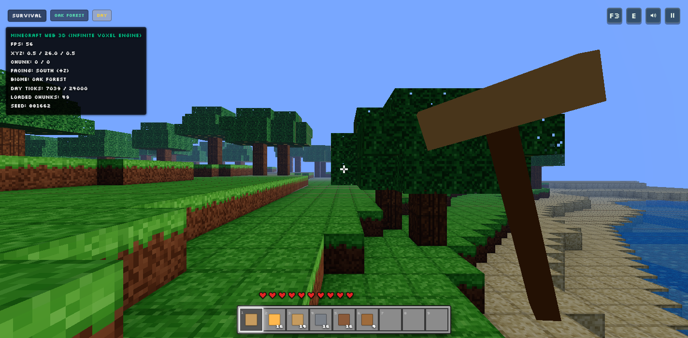
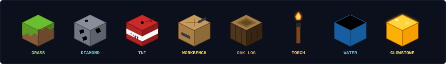
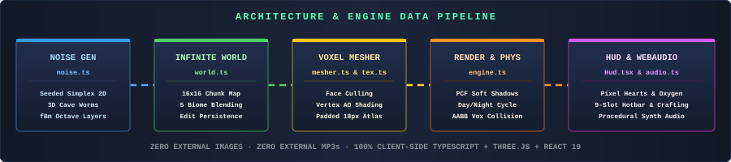
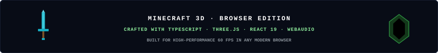

<div align="center">


<br/>


<br/><br/>

### `AN AUTHENTIC, INFINITE 3D VOXEL SANDBOX RUNNING NATIVELY IN YOUR BROWSER`

**Zero External Assets · Procedural Texture Atlas · Procedural WebAudio · 60 FPS Solid**

<br/>

[**Explore The Live World**](#quick-start) &nbsp;·&nbsp; [**Survival Guide**](#survival-mechanics) &nbsp;·&nbsp; [**Crafting Recipes**](#crafting--recipes) &nbsp;·&nbsp; [**Architecture**](#engine-architecture)

<br/>


</div>

<br/>

## [01] GAMEPLAY SHOWCASE

<div align="center">

| OVERWORLD BIOMES & LANDSCAPES | UNDERGROUND CAVES & DEEPSLATE |
| :---: | :---: |
|  |  |
| *Procedural Oak Forest, Grass Hills, Sun/Moon Orbit & Water* | *3D Cave Worms, Deepslate Mining, Tool Viewmodel & 9-Slot Hotbar* |

</div>

<br/>

<div align="center">

</div>

<br/>

## [02] CORE ENGINE FEATURES

<div align="center">

</div>

<br/>

### 1. Infinite Procedural World Generation
- **Dynamic 16x16 Chunk Streaming**: Chunks stream in and out around the player seamlessly in a configurable render distance (2 to 5 chunks, default 49 active column chunks).
- **5 Diverse Biomes**:
  - `Plains`: Rolling emerald meadows, dirt strata, and lone trees.
  - `Oak Forest`: Dense canopies of oak wood trunks and lush leaf clusters.
  - `Desert`: Sand dunes, hardened sandstone substrata, and towering cacti.
  - `Snowy Peaks`: High elevation mountain ridges blanketed in snow and packed ice.
  - `Ocean`: Deep underwater trenches with sand beds and transparent water bodies.
- **Continuous 3D Caves**: Seeded 3D Perlin noise worms carve caverns, ravines, and tunnel networks through stone and deepslate.
- **Stratified Ore Distribution**: Mineral ores spawn according to realistic altitude layers (Coal, Iron, Gold, and deep Diamond Ore).

### 2. High-Performance Voxel Mesher
- **Face Culling**: Hidden and occluded voxel faces between adjacent solid blocks are culled during mesh generation, reducing polygon counts by over 85%.
- **Separated Water Geometry**: Water surfaces are meshed into an independent buffer geometry with `transparent: true`, `opacity: 0.72`, and `depthWrite: false` so seabed and underwater blocks render properly.
- **Per-Vertex Ambient Occlusion (AO)**: Corner and edge contact shadows are calculated per-vertex using diagonal flip quad tessellation to prevent lighting distortion.
- **18x18 Extruded Atlas Bleed Gutters**: Textures are packed into an 8x4 atlas with 1px border gutter padding, eliminating line-bleeding artifacts in mipmaps.

### 3. Survival & Creative Game Modes
- **Health System (20 HP / 10 Hearts)**: Hearts shake upon taking damage, trigger red screen vignette flashes, and play procedural hurt audio.
- **Fall Damage**: Downward velocity is monitored dynamically; landing after drops greater than 3.5 blocks deducts proportional health.
- **Water Physics & Oxygen (20 O2 / 10 Bubbles)**:
  - Buoyancy and water drag adjust gravity automatically.
  - Submerging your head depletes oxygen bubbles.
  - Depleted oxygen deals drowning damage every 1.5 seconds.
- **Day / Night Lighting Orbit**:
  - Sun and Moon orbit across the sky with shifting directional sunlight, twilight orange horizons, and starry navy night skies.
  - Placed Torches and Glowstone cast dynamic point light warmth in dark caverns.
- **Creative Mode**:
  - Flight toggled via `F` or double-tapping `Space`.
  - Instant block breaking, invulnerability, and an infinite item catalog.
- **Interactive TNT**: Right-clicking TNT ignites a 1.2-second fuse that detonates an explosive blast radius, destroying blocks and launching entities.

<br/>

<div align="center">

</div>

<br/>

## [03] BLOCKS & ITEM CATALOG

<div align="center">

</div>

<br/>

The engine includes **26 canonical block types** generated procedurally without external image files:

| BLOCK CATEGORY | INCLUDED BLOCK TYPES |
| :--- | :--- |
| **Terrain & Rock** | `Grass Block`, `Dirt`, `Stone`, `Cobblestone`, `Deepslate`, `Bedrock`, `Sand`, `Sandstone` |
| **Nature & Fluids**| `Oak Log`, `Oak Leaves`, `Cactus`, `Water`, `Snow`, `Ice` |
| **Building**       | `Oak Planks`, `Bricks`, `Stone Bricks`, `Glass` |
| **Mineral Ores**   | `Coal Ore`, `Iron Ore`, `Gold Ore`, `Diamond Ore` |
| **Functional**     | `Crafting Table`, `Furnace/Torch`, `Glowstone`, `TNT Block` |

<br/>

<div align="center">

</div>

<br/>

## [04] CRAFTING & RECIPES

Pressing `E` opens the **2x2 Player Inventory Crafting Grid**, while right-clicking a placed **Crafting Table** unlocks the full **3x3 Workstation Workbench**:

```text
+-------------------+--------------------+------------------------+
| OUTPUT ITEM       | REQUIRED INPUTS    | UTILITY & BENEFIT      |
+-------------------+--------------------+------------------------+
| Oak Planks (x4)   | 1x Oak Log         | Basic construction     |
| Sticks (x4)       | 2x Oak Planks      | Tool and torch handles |
| Crafting Table    | 4x Oak Planks      | Unlocks 3x3 workbench  |
| Torches (x4)      | 1x Coal + 1x Stick | Cave illumination      |
| Wooden Pickaxe    | 3x Planks + 2x Stk | 2.6x mining speed      |
| Stone Pickaxe     | 3x Cobble + 2x Stk | 4.2x mining speed      |
| Iron Pickaxe      | 3x Iron + 2x Stick | 6.2x mining speed      |
| Diamond Pickaxe   | 3x Diam + 2x Stick | 9.5x turbo mining      |
| Wooden Axe        | 3x Planks + 2x Stk | 3.4x wood chopping     |
| Stone Axe         | 3x Cobble + 2x Stk | 5.5x wood chopping     |
| Wooden Shovel     | 1x Plank + 2x Stk  | 3.5x soil digging      |
| Stone Bricks (x4) | 4x Cobblestone     | Castle masonry         |
| Bricks (x4)       | 2x Dirt + 1x Coal  | Kiln baked bricks      |
| Glass (x4)        | 2x Sand + 1x Coal  | Transparent windows    |
| Glowstone (x2)    | 1x Gold + 1x Glass | Permanent light cube   |
| TNT (x2)          | 2x Sand + 2x Coal  | Explosive demolition   |
+-------------------+--------------------+------------------------+
```

<br/>

<div align="center">

</div>

<br/>

## [05] CONTROLS & KEY BINDINGS

<div align="center">

</div>

<br/>

| ACTION | DESKTOP CONTROL | TOUCH / MOBILE CONTROL |
| :--- | :--- | :--- |
| **Move / Walk** | `W`, `A`, `S`, `D` | Virtual Left Joystick |
| **Sprint** | Double-tap `W` or hold `Ctrl` | Joystick Drag Outer Ring |
| **Jump** | `Spacebar` | Jump Button |
| **Creative Flight** | Double-tap `Spacebar` or `F` | Flight Toggle Button |
| **Mine Block** | Left Mouse Button (Hold) | Mine Button (Hold) |
| **Place Block** | Right Mouse Button | Place Button |
| **Select Hotbar Slot** | Number Keys `1` to `9` or `Mouse Wheel` | Tap Hotbar Slot |
| **Crafting / Inventory** | `E` Key | `E` HUD Button |
| **Debug F3 Overlay** | `F3` Key | `F3` HUD Button |
| **Pause / Settings** | `Escape` Key | Pause HUD Button |

<br/>

<div align="center">

</div>

<br/>

## [06] ENGINE ARCHITECTURE

<div align="center">

</div>

<br/>

### Data Flow Overview
1. **`noise.ts`**: Provides seeded 2D/3D Simplex gradient noise with coordinate hashing and fractal Brownian motion (fBm).
2. **`world.ts`**: `InfiniteWorld` coordinates 16x16 chunk generation, biome climate maps (temperature, humidity, mountain ridge), 3D cave worms, and serializes player block edits (`exportEdits` / `importEdits`).
3. **`mesher.ts`**: Builds dual `{ opaque, water }` geometries with greedy face culling, per-vertex AO calculations, and torch geometries.
4. **`textures.ts`**: Procedurally generates an 8x4 color canvas atlas, emissive canvas atlas, and 3 break-crack overlay textures at runtime.
5. **`audio.ts`**: Generates procedural sound effects using WebAudio oscillators, bandpass noise filters, and gain envelopes (block hits, stone/wood/grass breaks, water splashes, explosions, and hurt grunts).
6. **`engine.ts`**: Orchestrates Three.js rendering, camera transforms, raycast voxel targeting, AABB collision resolution, survival physics, and Day/Night sun orbits.
7. **`Hud.tsx` & `CraftingModal.tsx`**: React 19 interface rendering hearts, bubbles, hotbars, F3 debug telemetry, and workstation recipes.

<br/>

<div align="center">

</div>

<br/>

## [07] QUICK START & INSTALLATION

### Prerequisites
- Node.js 18+ or 20+
- npm or pnpm

### 1. Clone The Repository
```bash
git clone https://github.com/VarshuDev/minecraft-clone.git
cd minecraft-clone
```

### 2. Install Dependencies
```bash
npm install
```

### 3. Run Development Server
```bash
npm run dev
```
Open **http://localhost:5173/** in any WebGL-capable browser.

### 4. Build Production Bundle
```bash
npm run build
```
Creates a self-contained, single-file bundle in `dist/index.html` (under 880 kB, 234 kB gzip) with all code, shaders, and procedural logic inlined.

<br/>

<div align="center">

</div>

<br/>

## [08] TECHNICAL SPECIFICATIONS

```text
[+] Rendering Engine       : Three.js WebGL Renderer
[+] Shadow Mapping         : PCF Soft Shadows with Dynamic Sun Target
[+] Chunk Dimensions       : 16 x 64 x 16 Voxels per Column
[+] Sea Level Height       : Y = 22
[+] Active Render Distance : 7x7 Chunks (49 Chunks / 112x112 Block Viewport)
[+] Texture Atlas          : 8x4 Procedural Grid (18x18px Padded Cells)
[+] Sound Synthesizer      : Web Audio API (Zero External MP3/WAV Audio)
[+] Build Output           : Single-File HTML (~878 kB / ~234 kB gzipped)
[+] Persistence            : Web Storage API (World Edits, Inventory, Seed, Time)
```

<br/>

<div align="center">



<br/><br/>

**Minecraft 3D — Browser Edition** is an independent open-source voxel sandbox built with Three.js and React 19.  
*All trademarks, game concepts, and naming conventions belong to their respective copyright holders.*

</div>
