<div align="center">

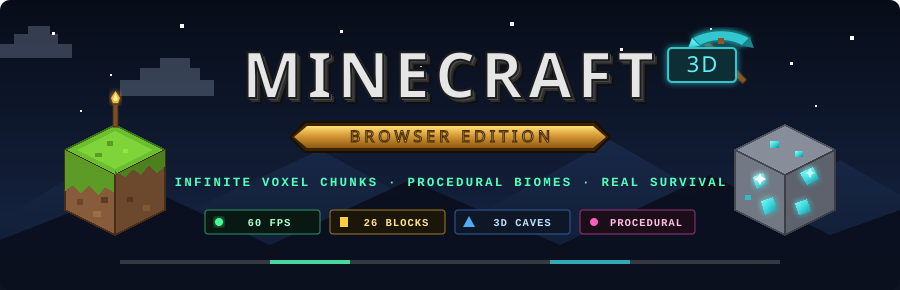

<br/>


<br/><br/>

### `AN AUTHENTIC, INFINITE 3D VOXEL SANDBOX RUNNING NATIVELY IN YOUR BROWSER`

**Zero External Assets · Procedural Texture Atlas · Procedural WebAudio · 60 FPS Solid**

<br/>

[**Explore The Live World**](#quick-start) &nbsp;·&nbsp; [**Survival Guide**](#survival-mechanics) &nbsp;·&nbsp; [**Crafting Recipes**](#crafting--recipes) &nbsp;·&nbsp; [**Architecture**](#engine-architecture)

<br/>


</div>

<br/>

## [01] GAMEPLAY SHOWCASE

<div align="center">

| OVERWORLD BIOMES & WILDLIFE | MOBS & SURVIVAL COMBAT |
| :---: | :---: |
|  | 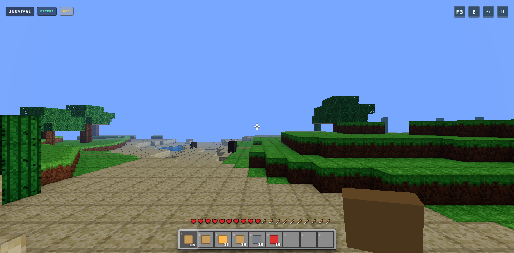 |
| *Oak Forests, Hills, Sun/Moon Orbit & Water* | *Natural Mobs, 10 Drumsticks & Hearts HUD* |

| DYNAMIC WEATHER, ARMOR & XP | INTERACTIVE SMELTING FURNACE |
| :---: | :---: |
| 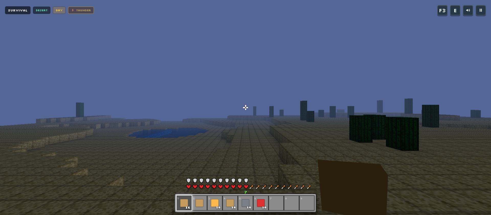 | 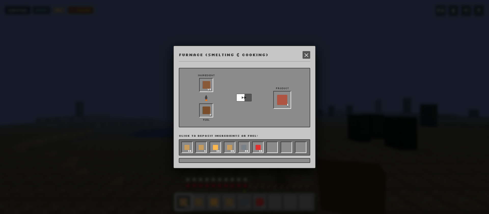 |
| *Rain, Snow, Thunderstorms, Armor Shields & XP Bar* | *Animated Burning Flame, Cooking Arrow & Fuels* |

| F5 3D STEVE & THIRD PERSON | IN-GAME CHAT & COMMAND CONSOLE |
| :---: | :---: |
| 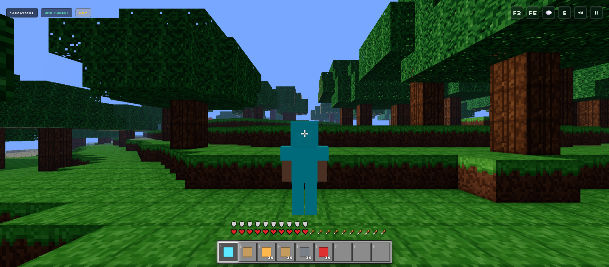 | 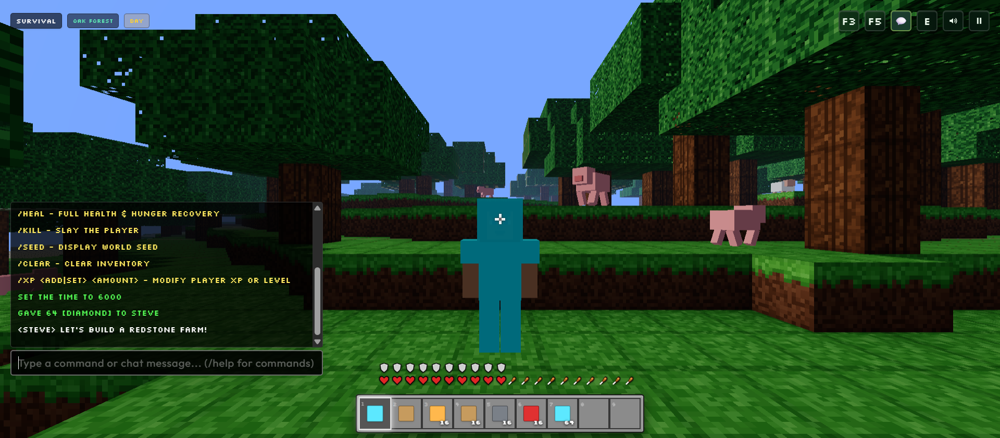 |
| *F5 Perspectives, 3D Steve Model, Armor Overlays & Animations* | *Real-Time Command Console, Slash Commands & History* |

| CROPS, AGRICULTURE & HARVESTING | REDSTONE LOGIC & MECHANICS |
| :---: | :---: |
| 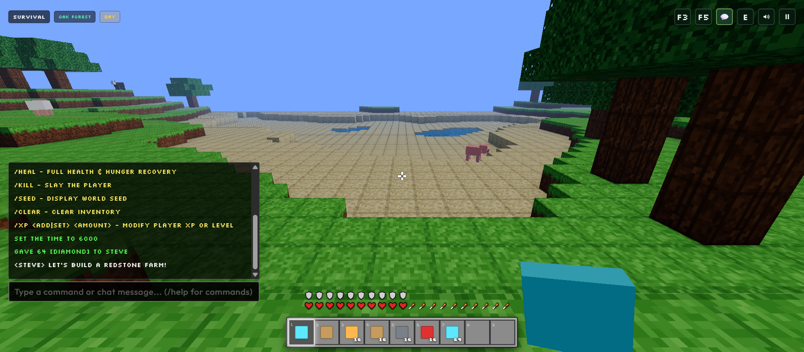 | 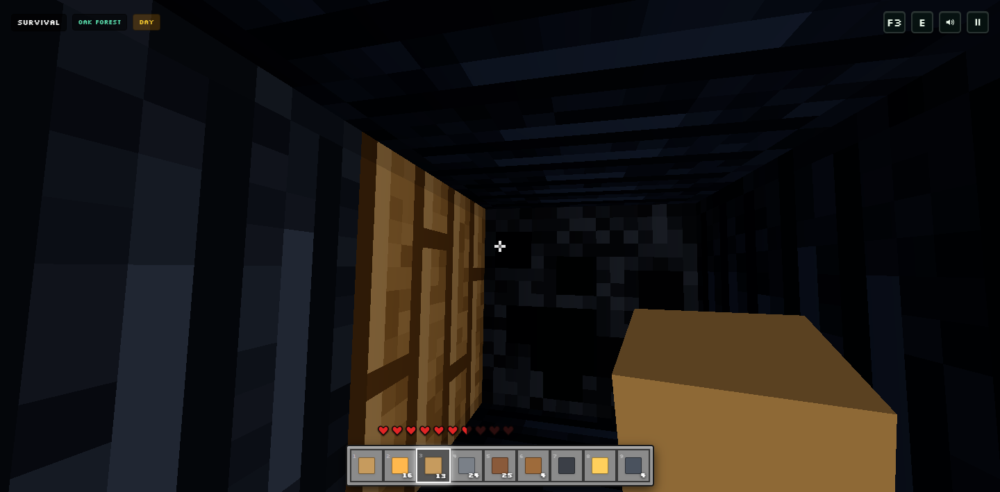 |
| *4 Wheat Growth Stages, Farmland Hydration & Bone Meal* | *Redstone Ore, Floor Wires, Levers, Lit Lamps & TNT* |

| THE NETHER DIMENSION & LAVA SEAS | ACTIVATED NETHER PORTALS |
| :---: | :---: |
| 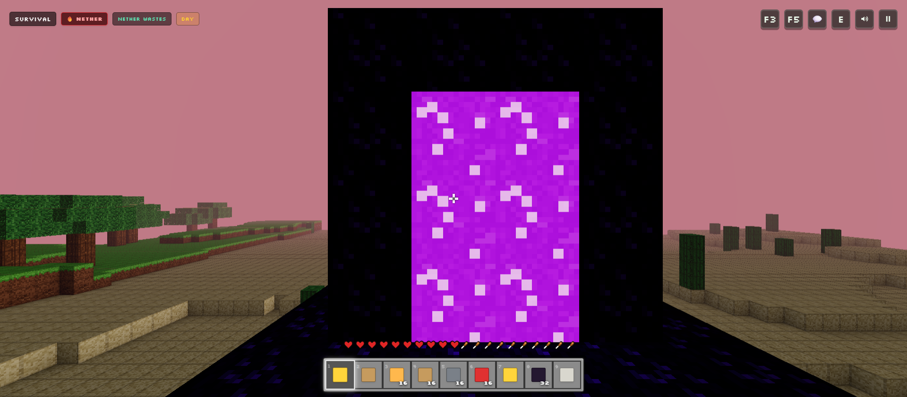 | 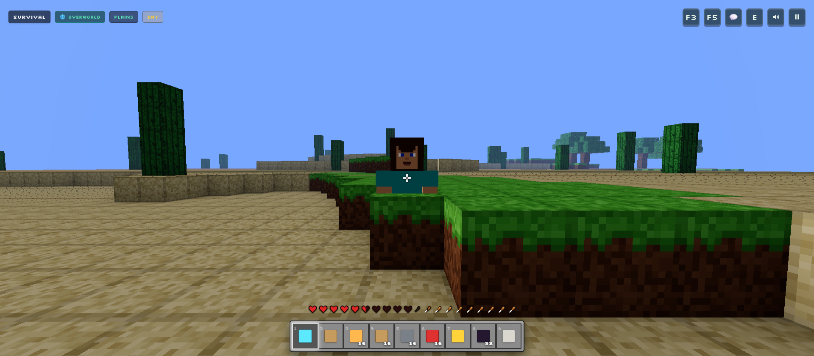 |
| *Netherrack Caverns, Lava Oceans, Soul Sand & Nether Mobs* | *4x5 Obsidian Portal Frame, Flint & Steel Ignition & Travel* |

| ENCHANTING TABLE & 3D SPELLBOOK | INTERACTIVE ENCHANTING UI & RUNES |
| :---: | :---: |
| 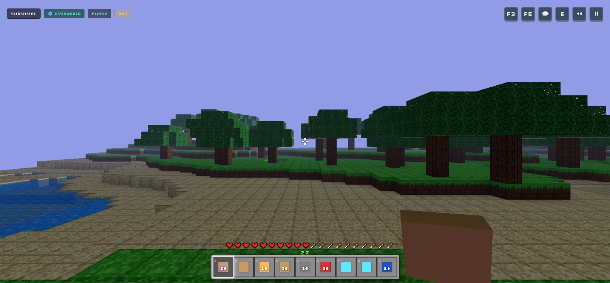 | 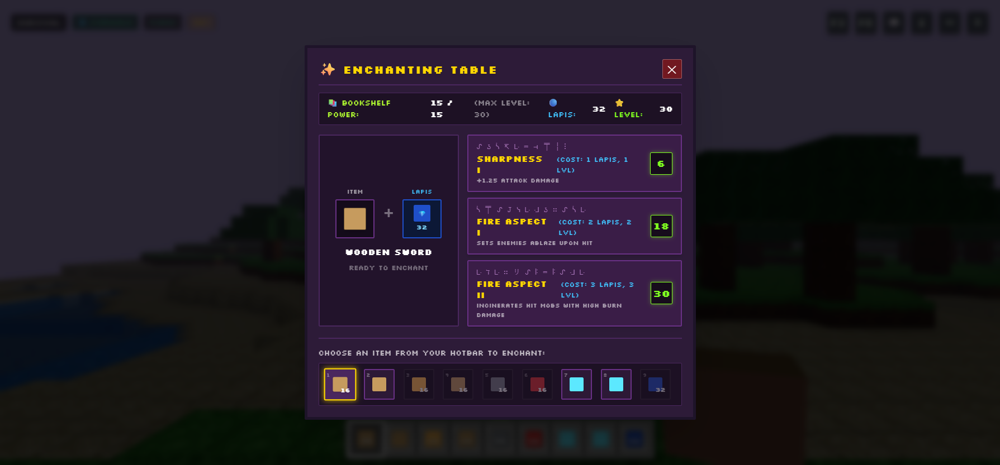 |
| *Floating 3D Spellbook, Drifting Runic Particles & Bookshelves* | *Standard Galactic Alphabet Runes, 3 Tiers, Lapis & XP Costs* |

</div>

<br/>

<div align="center">

</div>

<br/>

## [02] CORE ENGINE FEATURES

<div align="center">
</div>

<br/>

### 1. Infinite Procedural World Generation
- **Dynamic 16x16 Chunk Streaming**: Chunks stream in and out around the player seamlessly in a configurable render distance (2 to 5 chunks, default 49 active column chunks).
- **5 Diverse Biomes**:
  - `Plains`: Rolling emerald meadows, dirt strata, poppies, dandelions, and peaceful wildlife.
  - `Oak Forest`: Dense canopies of oak wood trunks, lush leaf clusters, and rich terrain.
  - `Desert`: Sand dunes, hardened sandstone substrata, and towering prickly cacti.
  - `Snowy Peaks`: High elevation mountain ridges blanketed in snow and packed ice.
  - `Ocean`: Deep underwater trenches with sand beds and transparent water bodies.
- **Continuous 3D Caves**: Seeded 3D Perlin noise worms carve caverns, ravines, and tunnel networks through stone and deepslate.
- **Stratified Ore Distribution**: Mineral ores spawn according to realistic altitude layers (Coal, Iron, Gold, and deep Diamond Ore).

### 2. Mobs & AI Entity System
- **6 Canonical 3D Voxel Mob Species**:
  - `Zombie`: Hostile undead that wanders, tracks, and chases players. Burns in open daylight. Drops rotten flesh.
  - `Skeleton`: Ranged undead archer armed with bow and arrow, firing ballistic projectiles at range. Burns in daylight. Drops bones and arrows.
  - `Creeper`: Silent stalking explosive mob that approaches player, hisses, swells, flashes white/green, and detonates TNT blast. Drops gunpowder.
  - `Pig`: Friendly pink farm animal that wanders grass plains with trot walking animations. Drops raw porkchops.
  - `Cow`: Iconic spotted bovine mob with horns. Drops raw beef and leather.
  - `Sheep`: Fluffy woolly animal with head and hooves. Drops wool blocks.
- **Pathfinding & AI State Machine**: Wander, chase, flee, ranged attack, and fuse countdowns with obstacle step-up jumping.
- **Natural Spawning System**: Spawns peaceful farm animals on sunlit surface grass, and hostile monsters in dark underground caves or during the night.
- **Combat Feedback**: Red hurt flash, knockback impulse, procedural groans/hisses/moos, and death drop yields.

### 3. Dynamic Weather System
- **Precipitation Simulation**: 1,200 particle instances dynamically wrap around the player camera:
  - `Plains / Forest / Ocean`: Rapid falling raindrops with light blue streaks (`#a0d8ef`).
  - `Snowy Peaks`: Gentle fluttering snowflakes with organic sinusoidal wind drift (`#ffffff`).
  - `Desert`: Overcast clouds without precipitation (authentic Minecraft climate rule).
- **Atmospheric Dimming & Lightning**: Storm sky shifts to dark slate (`#323a48`), fog thickens, and random lightning flashes burst with 2.4x ambient intensity and booming WebAudio lowpass thunder crackles (`audio.thunderRumble()`).
- **Weather State Machine**: Automatically cycles between `Clear`, `Rain`, and `Thunderstorm`, with real-time UI indicator badges on the HUD.

### 4. Armor & Defense System
- **10 Silver Armor Shields**: Renders directly above the 10 hearts on the HUD to display current defense rating (up to 20 defense points = 80% damage reduction).
- **Full Armor Sets**:
  - `Leather`: Tunic and Boots (7 defense points).
  - `Iron`: Helmet, Chestplate, Leggings, and Boots (15 defense points = 60% reduction).
  - `Diamond`: Full Diamond Set (20 defense points = 80% maximum damage reduction).
- **Interactive Armor Rack**: View equipped armor in the inventory modal (`E`), click equipped armor to remove it, or right-click any armor piece in your hotbar to instantly equip it with authentic metallic clinking sound.

### 5. Experience & Leveling System
- **Green XP Progress Bar & Level Badge**: Renders centered above the 9-slot hotbar with glowing Minecraft green `#80ff20` level numbers.
- **Magnetic XP Orbs**: Defeating hostile mobs (+5 XP), farm animals (+2 XP), mining mineral ores (Coal, Iron, Gold, Diamond), and smelting items spawns floating, spinning lime/yellow 3D XP orbs.
- **Orb Physics & Magnetic Pull**: XP orbs float with gentle gravity, magnetizing toward the player within 6 blocks. Collecting orbs plays an escalating chime series (`audio.xpChime()`), and leveling up triggers a celebratory 5-note fanfare.

### 6. Interactive 27-Slot Chest & Smelting Furnace UIs
- **Dedicated Chest Modal**: Authentic 27-slot chest grid (3x9) plus 27-slot player inventory and 9-slot hotbar. Click items to transfer seamlessly between chest storage and inventory; saves per-coordinate in world data.
- **Dedicated Smelting Furnace**: Authentic 3-slot smelting workstation with:
  - Animated burning flame icon reflecting remaining fuel burn time.
  - Cooking progress arrow filling smoothly as items smelt (6 seconds per item).
  - Real fuel durations: Coal burns for 8 smelts (80s), Wood/Logs burn for 1.5 smelts (15s), Sticks burn for 5s.
  - Full smelting matrix: Raw Beef/Pork into Steaks/Cooked Pork, Iron/Gold Ores into Ingots, Sand into Glass, Cobblestone into Smooth Stone, and Dirt into Bricks.

### 7. Weapons & Melee Combat
- **Swords**: Wooden, Stone, Iron, and Diamond Swords with distinct damage ratings (+4 to +7 Attack Damage) and first-person 3D sword viewmodels with crossguards and pommels.
- **Bow & Projectile Physics**: Ballistic gravity arc trajectories with voxel terrain collision, mob hit detection, and sound effects.
- **Hit Detection**: Left-click raycast targets mobs within reach before block mining, applying weapon damage and knockback.

### 8. Hunger & Food System
- **10 Drumstick Bar (20 Hunger)**: Hunger depletes during sprinting and jumping; sprinting is disabled when hunger falls to 6 or below.
- **Natural Regeneration & Starvation**: When satiated (18+ hunger), health gently regenerates. When hunger reaches 0, starvation damage occurs.
- **Food Items**: Apples, Bread, Raw/Cooked Porkchops, and Raw/Cooked Beef (Steak). Right-click to eat with crunchy chewing audio.

### 9. Interactive Blocks, Bed & Underwater
- **Bed**: Right-click at night to sleep through the night, fast-forwarding to dawn and setting your respawn point with sleep chime.
- **Wooden Door**: Toggle open/close with wooden latch sound.
- **Ladders**: Climbable vertical surface ladders for shaft descents.
- **Underwater Atmosphere**: Dives shift scene fog to deep ocean cyan (`#0d3859`), trigger an underwater blue caustic tint vignette, and deplete oxygen bubbles with drowning damage.

### 10. Procedural C418-Style Ambient Soundtrack
- **Procedural Ambient Piano**: Synthesizes gentle, reflective ambient piano and Rhodes chord progressions in pentatonic/Lydian harmony ("Wet Hands", "Sweden" inspired) with zero megabytes of audio downloads.
- **Procedural Soundscape**: Authentic WebAudio synthesis for mob groans, hisses, oinks, moos, arrow shots, footstep surfaces, water splashes, thunder rumbles, and tool strikes.

### 11. F5 Third-Person Perspectives & 3D Steve Character Model
- **Multiple Camera Modes (`F5`)**: Seamlessly cycle between `First-Person`, `Third-Person (Back)`, and `Third-Person (Front)` perspectives with audio switch chimes.
- **Procedural 3D Steve Character Model**:
  - Pixel-art Steve facial features, blue eyes, hair bangs, cyan shirt, blue denim jeans, and shoes.
  - Dynamic visual armor overlays: equipped helmets, chestplates with shoulder pauldrons, leggings, and boots render directly on Steve in 3D!
  - Equipped held tools and weapons (Diamond Swords, Pickaxes, Blocks) attach to Steve's right hand.
- **Procedural Skeletal Animation**:
  - Legs and arms swing naturally in counter-phase during walking (`Math.sin(walkBob)`).
  - Right arm pitches and sweeps during mining, block placement, and melee sword swings.
  - Head tilts and pitches according to mouse look angle.
- **Collision Obstacle Avoidance**: 3rd-person camera raycasts behind and in front of the player to prevent clipping into cliffs, trees, or cavern walls.

### 12. In-Game Chat & Command Console (`/` or `T`)
- **Interactive Chat Overlay**: Bottom-left transparent black message console with auto-focus input bar, command history recall (Up/Down arrow keys), and 8.5-second auto-fading recent messages.
- **Built-In Slash Commands**:
  - `/gamemode <survival|creative>`: Instant gamemode switching with flight and inventory unlocks.
  - `/time set <day|noon|sunset|night|midnight|<ticks>>`: Instantly manipulate the day/night celestial clock.
  - `/weather <clear|rain|thunder>`: Set atmospheric weather and ambient storm audio.
  - `/tp <x> <y> <z>`: Instant player coordinate teleportation with immediate chunk streaming.
  - `/give <item_id> [count]`: Give any block, tool, or weapon directly to player inventory.
  - `/heal`: Instant full health, hunger, and saturation restoration.
  - `/kill`: Slay Steve for respawn testing.
  - `/seed`: Inspect the active world generation seed.
  - `/clear`: Wipe player inventory and hotbar.
  - `/dimension <overworld|nether>`: Teleport between the Overworld and Nether dimensions.
  - `/xp <add|set> <amount>`: Add XP or set experience level.
  - `/help`: Detailed command syntax and descriptions.
- **Player Chat**: Messages without `/` are displayed in authentic `<Steve> message` chat formatting!

### 13. Crops & Agriculture Simulation
- **4 Distinct Wheat Growth Stages**: Tiny germinating sprouts (`Stage 1`) -> young green shoots (`Stage 2`) -> tall yellowish stalks (`Stage 3`) -> fully mature golden wheat with grain husks (`Stage 4`).
- **Farmland Hydration**: Farmland within 4 horizontal blocks of `Water` darkens into moist rich soil (`#291a0e`), accelerating crop growth speed.
- **Bone Meal Fertilizer**: Crafted from skeleton bones (`1 Bone -> 3 Bone Meal`); right-clicking bone meal on crops instantly promotes growth with magical green sparkle particles and chime audio!
- **Harvesting & Replanting**: Harvesting mature wheat drops 1 `Wheat` (for bread) + 1-3 `Seeds` for continuous farming expansion.

### 14. Redstone Engineering & Mechanics
- **Redstone Ore**: Deep underground stone with glowing crimson veins emitting ambient light.
- **Redstone Wire**: Floor-mounted redstone dust tracks conveying electrical power.
- **Toggleable Levers**: Wall/floor mounted mechanical levers that toggle ON/OFF with crisp clicking audio.
- **Redstone Lamps**: Unlit lamps (`#3d2817`) ignite into brilliant glowing amber lamps (`#ffe27a`) with emissive light when powered!
- **Power Automation**: Powering adjacent `TNT` primes and detonates it; powering `Wooden Doors` swings them open/closed!

### 15. The Nether Dimension & Obsidian Portals
- **Authentic Nether Dimension Generation**:
  - `Bedrock Ceiling & Floor`: Solid unbreakable bedrock barriers at $Y = 63$ and $Y = 0$ with stalactites and stalagmites.
  - `Netherrack Caverns & Lava Ocean`: 3D noise tunnels carved through blood-red Netherrack with an ocean of bubbling Lava at $Y = 1..13$.
  - `Soul Sand Shores & Pockets`: Eerie brown soul sand banks that slow player walking speed by 50%.
  - `Nether Quartz Veins & Glowstone`: Rich veins of glistening Nether Quartz ore embedded in cavern walls and hanging Glowstone clusters illuminating the ceilings.
  - `Crimson Atmosphere`: Thick red fog (`#380b0b`), deep crimson ambient illumination, and celestial suppression.
- **Obsidian Nether Portals**:
  - Build vertical $4 \times 5$ Obsidian frames (along X or Z axis).
  - Strike the portal with **Flint and Steel** to ignite swirling purple portal blocks with spark particles and sound.
  - Standing inside the portal for 2.0 seconds triggers dimensional teleportation with canonical **8:1 coordinate compression** between Overworld and Nether!
  - Generates reciprocal exit portal frames with safe platform footing at destination coordinates.
- **Lava Dynamics & Fluid Quenching**:
  - High-viscosity fluid physics (slows player to 45% speed) with periodic burn damage ticks.
  - Pouring or placing Water adjacent to Lava immediately quenches it into **Obsidian** with steam hiss audio and smoke particle bursts!
- **Nether Mob Species**:
  - `Zombie Pigman`: Neutral mob with half-pig half-zombie skin wielding a 3D Golden Sword. Peaceful until attacked, then rallies in relentless aggressive pursuit. Drops gold ingots and rotten flesh.
  - `Ghast`: Floating 1.5-meter flying ghost with red crying eyes and 9 swaying dangling tentacles that drifts through Nether caverns. Drops gunpowder.

### 16. Enchanting, Bookshelf Magic & Runic Power
- **Enchanting Table Workstation**:
  - Crafted with Obsidian, Diamonds, and a Book. Features authentic 3/4-height meshing (`0.75`) and procedural obsidian base with crimson diamond-pattern cloth drape and glowing cyan corners.
  - **3D Floating Spellbook**: Procedural 3D open book model floats and hovers above nearby Enchanting Tables, automatically rotating to face the player.
  - **Drifting Runic Glyphs**: Surrounding bookshelves channel arcane power, casting glowing cyan and gold runic particles drifting toward the open spellbook.
- **Bookshelf Influence (0 to 15 Power)**:
  - Scans a $5 \times 3 \times 5$ cuboid centered on the enchanting table for placed `Bookshelf` blocks.
  - Power scales up to 15 bookshelves, elevating maximum enchantment offers from Level 6 up to **Level 30**!
- **Authentic Enchanting Modal & Runes**:
  - Features authentic **Standard Galactic Alphabet** cryptic runes, 3 dynamic tier offers, bookshelf power indicator (`0 / 15`), and real-time lapis counter.
  - Requires both player XP levels and **Lapis Lazuli** gems (`1 Lapis + 1 LVL` for Tier 1, up to `3 Lapis + 3 LVL` for Tier 3).
- **7 Canonical Enchantments**:
  - `Sharpness` (I–V): Adds $+1.25 \times \text{level}$ melee damage to swords.
  - `Fire Aspect` (I–II): Sets hit targets ablaze with burning fire ticks and hurt flashes.
  - `Knockback` (I–II): Significantly amplifies knockback impulse applied to hit mobs.
  - `Efficiency` (I–V): Accelerates tool mining speed by $1 + \text{level} \times 0.35$.
  - `Fortune` (I–III): Multiplies mineral drop yields from Coal, Diamond, Redstone, Lapis, and Quartz up to $3\times$.
  - `Protection` (I–IV): Adds $+4\%$ damage reduction per level to equipped armor pieces.
  - `Unbreaking` (I–III): Multiplies tool durability and lifespan.
- **Visual Glint & Audio Synthesis**:
  - Enchanted tools in first-person view shine with an animated, pulsating purple iridescent shimmer (`#7b1fa2`).
  - Procedural enchanting audio: ascending pentatonic glockenspiel arpeggio (`audio.enchant()`) and parchment flutter bell chimes (`audio.spellBookOpen()`).
- **Natural Lapis Lazuli Ores**:
  - Deep underground Lapis Lazuli veins spawn naturally in stone/deepslate layers ($Y = 6..24$). Mining yields 4–9 royal blue Lapis Lazuli gems (boosted by Fortune).

<br/>

<div align="center">

</div>

<br/>

## [03] BLOCKS & ITEM CATALOG

<div align="center">

</div>

<br/>

The engine includes **65+ canonical block types & functional items** generated procedurally without external image files:

| BLOCK CATEGORY | INCLUDED BLOCK TYPES |
| :--- | :--- |
| **Terrain & Rock** | `Grass Block`, `Dirt`, `Stone`, `Cobblestone`, `Deepslate`, `Bedrock`, `Sand`, `Sandstone`, `Gravel` |
| **The Nether**     | `Netherrack`, `Lava (Fluid)`, `Obsidian`, `Nether Quartz Ore`, `Soul Sand`, `Nether Portal`, `Block of Quartz` |
| **Nature & Fluids**| `Oak Log`, `Oak Leaves`, `Cactus`, `Water (Fluid)`, `Snow`, `Ice`, `Poppy`, `Dandelion` |
| **Building**       | `Oak Planks`, `Bricks`, `Stone Bricks`, `Glass`, `Block of Quartz`, `Bookshelf` |
| **Mineral Ores**   | `Coal Ore`, `Iron Ore`, `Gold Ore`, `Diamond Ore`, `Redstone Ore`, `Nether Quartz Ore`, `Lapis Lazuli Ore` |
| **Agriculture**    | `Farmland`, `Moist Farmland`, `Wheat Crops (Stages 1-4)`, `Wheat Seeds`, `Wheat`, `Bone Meal` |
| **Redstone Power** | `Redstone Wire`, `Redstone Torch`, `Lever`, `Redstone Lamp (Unlit/Lit)`, `TNT Block` |
| **Functional & Home** | `Crafting Table`, `Furnace`, `Chest`, `Bed`, `Wooden Door`, `Ladder`, `Torch`, `Glowstone`, `Enchanting Table` |
| **Armor & Defense**| `Iron Helmet/Chestplate/Leggings/Boots`, `Diamond Helmet/Chestplate/Leggings/Boots`, `Leather Tunic/Boots` |
| **Weapons & Tools**| `Wooden/Stone/Iron/Diamond Swords`, `Golden Sword`, `Bow & Arrows`, `Pickaxes`, `Axes`, `Shovels`, `Wooden Hoe`, `Flint and Steel` |
| **Food & Mob Drops**| `Apple`, `Bread`, `Raw/Cooked Porkchop`, `Steak`, `Rotten Flesh`, `Bone`, `Gunpowder`, `String`, `Feather`, `Leather`, `Wool`, `Flint`, `Quartz`, `Gold Ingot`, `Lapis Lazuli`, `Book` |

<br/>

<div align="center">

</div>

<br/>

## [04] CRAFTING & RECIPES

Pressing `E` opens the **2x2 Player Inventory Crafting Grid**, while right-clicking a placed **Crafting Table** unlocks the full **3x3 Workstation Workbench**:

```text
+-------------------+--------------------+------------------------+
| OUTPUT ITEM       | REQUIRED INPUTS    | UTILITY & BENEFIT      |
+-------------------+--------------------+------------------------+
| Oak Planks (x4)   | 1x Oak Log         | Basic construction     |
| Sticks (x4)       | 2x Oak Planks      | Tool and torch handles |
| Crafting Table    | 4x Oak Planks      | Unlocks 3x3 workbench  |
| Furnace           | 8x Cobblestone     | Smelting & cooking     |
| Chest             | 8x Oak Planks      | Persistent item store  |
| Bed               | 3x Wool + 3x Plank | Sleep & set spawn point|
| Wooden Door       | 6x Oak Planks      | Hinged entry door      |
| Ladders (x3)      | 7x Sticks          | Climbable wall ladders |
| Torches (x4)      | 1x Coal + 1x Stick | Cave illumination      |
| Wooden Sword      | 2x Plank + 1x Stk  | +4 Attack Damage       |
| Stone Sword       | 2x Cobble + 1x Stk | +5 Attack Damage       |
| Iron Sword        | 2x Iron + 1x Stick | +6 Attack Damage       |
| Diamond Sword     | 2x Diam + 1x Stick | +7 Attack Damage       |
| Bow               | 3x Stick + 3x Str  | Ranged projectile shot |
| Arrows (x4)       | 1x Fthr + 1x Stk   | Bow ammunition         |
| Wooden Hoe        | 2x Plank + 2x Stk  | Till soil for farming  |
| Bread             | 3x Wheat           | Restores 5 hunger      |
| Cooked Porkchop   | 1x Pork + 1x Coal  | Restores 8 hunger      |
| Steak             | 1x Beef + 1x Coal  | Restores 8 hunger      |
| Wooden Pickaxe    | 3x Planks + 2x Stk | 2.6x mining speed      |
| Stone Pickaxe     | 3x Cobble + 2x Stk | 4.2x mining speed      |
| Iron Pickaxe      | 3x Iron + 2x Stick | 6.2x mining speed      |
| Diamond Pickaxe   | 3x Diam + 2x Stick | 9.5x turbo mining      |
| Wooden Axe        | 3x Planks + 2x Stk | 3.4x wood chopping     |
| Stone Axe         | 3x Cobble + 2x Stk | 5.5x wood chopping     |
| Wooden Shovel     | 1x Plank + 2x Stk  | 3.5x soil digging      |
| Iron Helmet       | 5x Iron Ingot      | +2 Armor Defense       |
| Iron Chestplate   | 8x Iron Ingot      | +6 Armor Defense       |
| Iron Leggings     | 7x Iron Ingot      | +5 Armor Defense       |
| Iron Boots        | 4x Iron Ingot      | +2 Armor Defense       |
| Diamond Helmet    | 5x Diamond         | +3 Armor Defense       |
| Diamond Chestplate| 8x Diamond         | +8 Armor Defense       |
| Diamond Leggings  | 7x Diamond         | +6 Armor Defense       |
| Diamond Boots     | 4x Diamond         | +3 Armor Defense       |
| Leather Tunic     | 8x Leather         | +3 Armor Defense       |
| Leather Boots     | 4x Leather         | +1 Armor Defense       |
| Stone Bricks (x4) | 4x Cobblestone     | Castle masonry         |
| Bricks (x4)       | 2x Dirt + 1x Coal  | Kiln baked bricks      |
| Glass (x4)        | 2x Sand + 1x Coal  | Transparent windows    |
| Glowstone (x2)    | 1x Gold + 1x Glass | Permanent light cube   |
| TNT (x2)          | 2x Sand + 2x Coal  | Explosive demolition   |
| Bone Meal (x3)    | 1x Skeleton Bone   | Instant crop fertilizer|
| Lever             | 1x Stick + 1x Cobbl| Mechanical power switch|
| Redstone Torch    | 1x Stick + 1x Redst| Power generator        |
| Redstone Lamp     | 1x Glowst + 4x Red | Switchable amber light  |
| Flint and Steel   | 1x Iron + 1x Flint | Ignites Nether Portals |
| Golden Sword      | 2x Gold + 1x Stick | +5 Attack Damage       |
| Block of Quartz   | 4x Nether Quartz   | Smooth white building  |
| Book              | 3x Wheat + 1x Leath| Arcane crafting item    |
| Bookshelf         | 6x Plank + 3x Book | Empowers Enchanting    |
| Enchanting Table  | 4x Obsid+2x Dia+1xB| Arcane weapon/armor buff|
+-------------------+--------------------+------------------------+
```

### Furnace Smelting Matrix

Right-click any placed **Furnace** to smelt raw minerals, meats, and materials using Coal (8 smelts / 80s), Wood (1.5 smelts / 15s), or Sticks:

```text
+-------------------+--------------------+-------------------------+
| RAW INGREDIENT    | COOKED PRODUCT     | FUEL CONSUMED & XP      |
+-------------------+--------------------+-------------------------+
| Raw Beef          | Steak              | 1/8 Coal (+0.5 XP)      |
| Raw Porkchop      | Cooked Porkchop    | 1/8 Coal (+0.5 XP)      |
| Iron Ore          | Iron Ingot         | 1/8 Coal (+1.0 XP)      |
| Gold Ore          | Gold Ingot         | 1/8 Coal (+1.5 XP)      |
| Redstone Ore      | Redstone Dust      | 1/8 Coal (+0.7 XP)      |
| Sand              | Clear Glass        | 1/8 Coal (+0.2 XP)      |
| Cobblestone       | Smooth Stone       | 1/8 Coal (+0.2 XP)      |
| Dirt              | Baked Bricks       | 1/8 Coal (+0.3 XP)      |
| Nether Quartz Ore | Nether Quartz      | 1/8 Coal (+1.0 XP)      |
| Lapis Lazuli Ore  | Lapis Lazuli       | 1/8 Coal (+1.0 XP)      |
+-------------------+--------------------+-------------------------+
```

<br/>

<div align="center">

</div>

<br/>

## [05] CONTROLS & KEY BINDINGS

<div align="center">
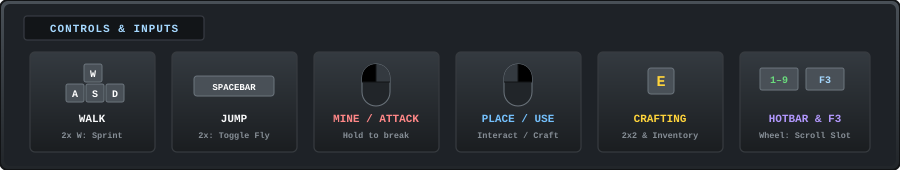
</div>

<br/>

| ACTION | DESKTOP CONTROL | TOUCH / MOBILE CONTROL |
| :--- | :--- | :--- |
| **Move / Walk** | `W`, `A`, `S`, `D` | Virtual Left Joystick |
| **Sprint** | Double-tap `W` or hold `Ctrl` | Joystick Drag Outer Ring |
| **Jump** | `Spacebar` | Jump Button |
| **Creative Flight** | Double-tap `Spacebar` or `F` | Flight Toggle Button |
| **Mine Block** | Left Mouse Button (Hold) | Mine Button (Hold) |
| **Place Block** | Right Mouse Button | Place Button |
| **Select Hotbar Slot** | Number Keys `1` to `9` or `Mouse Wheel` | Tap Hotbar Slot |
| **Crafting / Inventory** | `E` Key | `E` HUD Button |
| **Camera Perspective** | `F5` Key (1st / 3rd Back / 3rd Front) | `F5` HUD Button |
| **Chat & Slash Commands** | `T` or `/` Keys | `💬` HUD Button |
| **Debug F3 Overlay** | `F3` Key | `F3` HUD Button |
| **Pause / Settings** | `Escape` Key | Pause HUD Button |

<br/>

<div align="center">

</div>

<br/>

## [06] ENGINE ARCHITECTURE

<div align="center">

</div>

<br/>

### Data Flow Overview
1. **`noise.ts`**: Provides seeded 2D/3D Simplex gradient noise with coordinate hashing and fractal Brownian motion (fBm).
2. **`world.ts`**: `InfiniteWorld` coordinates 16x16 chunk generation, biome climate maps (temperature, humidity, mountain ridge), 3D cave worms, and serializes player block edits (`exportEdits` / `importEdits`).
3. **`mesher.ts`**: Builds dual `{ opaque, water }` geometries with greedy face culling, per-vertex AO calculations, torch models, cross-billboard flower geometry, and custom height scaling for beds and tilled farmland.
4. **`textures.ts`**: Procedurally generates an 8x6 color canvas atlas, emissive canvas atlas, and 3 break-crack overlay textures at runtime.
5. **`mobs.ts`**: `MobManager` drives 6 distinct 3D voxel mob models (Zombie, Skeleton, Creeper, Pig, Cow, Sheep), state machine AI (wander, chase, flee, fuse explosion), ballistic arrow projectiles, daylight burning, and natural spawning.
6. **`audio.ts`**: Procedural WebAudio sound synthesizer (hits, breaks, footstep surfaces, splashes, explosions, hurt grunts, mob groans, hisses, moos, oinks, arrow twangs, eating chomps) and procedural C418-style ambient soundtrack.
7. **`engine.ts`**: Orchestrates Three.js rendering, camera transforms, raycast combat & mining, hunger & saturation drain, natural health regen, bed sleep skip, ladder climbing, and day/night orbits.
8. **`Hud.tsx` & `CraftingModal.tsx`**: React 19 interface rendering 10 hearts, 10 drumsticks, oxygen bubbles, 9-slot hotbar, F3 telemetry, and categorised workstation recipes.

<br/>

<div align="center">

</div>

<br/>

## [07] QUICK START & INSTALLATION

### Prerequisites
- Node.js 18+ or 20+
- npm or pnpm

### 1. Clone The Repository
```bash
git clone https://github.com/VarshuDev/minecraft-clone.git
cd minecraft-clone
```

### 2. Install Dependencies
```bash
npm install
```

### 3. Run Development Server
```bash
npm run dev
```
Open **http://localhost:5173/** in any WebGL-capable browser.

### 4. Build Production Bundle
```bash
npm run build
```
Creates a self-contained, single-file bundle in `dist/index.html` (under 916 kB, 243 kB gzip) with all code, shaders, textures, audio synthesis, and procedural logic inlined.

<br/>

<div align="center">

</div>

<br/>

## [08] TECHNICAL SPECIFICATIONS

```text
[+] Rendering Engine       : Three.js WebGL Renderer (PCF Shadow Maps, ACES Filmic)
[+] Chunk Dimensions       : 16 x 64 x 16 Voxels per Column
[+] Active Dimensions      : Overworld & The Nether (8:1 Coordinate Ratio)
[+] Sea Level Height       : Y = 22 (Overworld) / Y = 13 Lava Ocean (Nether)
[+] Active Render Distance : 7x7 Chunks (49 Chunks / 112x112 Block Viewport)
[+] Texture Atlas          : 8x10 Procedural Grid (80 Canonical 18x18px Gutter Cells)
[+] Mobs & Entities        : 8 Species (Zombie, Skeleton, Creeper, Pig, Cow, Sheep, Zombie Pigman, Ghast)
[+] Sound Synthesizer      : Web Audio API (Zero External MP3/WAV Audio Files)
[+] Ambient Soundtrack     : Procedural C418-Style Calm Piano Synthesizer
[+] Build Output           : Single-File HTML (~1,033 kB / ~271 kB gzipped)
[+] Persistence            : Web Storage API (Multi-World Edits, Dimensions, Inventory, Seed)
```

<br/>

<div align="center">


<br/><br/>

**Minecraft 3D — Browser Edition** is an independent open-source voxel sandbox built with Three.js and React 19.  
*All trademarks, game concepts, and naming conventions belong to their respective copyright holders.*

</div>
